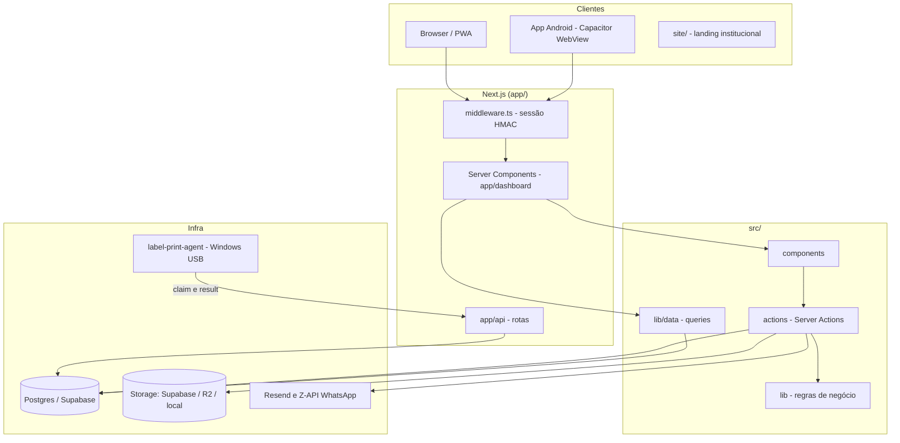
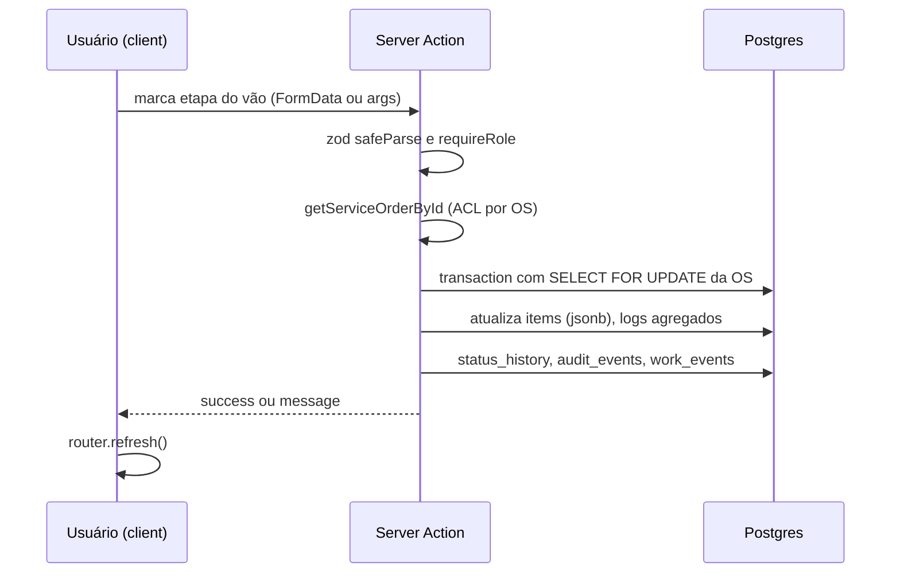

# Codebase Map

> Gerado pelo Cartographer. Último mapeamento: 2026-10-08T13:57:58Z

## Visão geral

**Fluxo Diógenes** (`fluxo-diogenes`) é um sistema de logística para uma vidraçaria. Cada **OS** (ordem de serviço) é uma linha de `measurements`, e cada **vão** (peça a instalar) fica dentro do jsonb `items`. A OS percorre medição, corte, transporte e instalação, e cada etapa é concluída por um papel diferente.

**Stack**: Next.js 15 (App Router), React 19, Tailwind 4, Drizzle ORM sobre Postgres (Supabase), Zod, PWA com Serwist, Dexie para offline, Capacitor (WebView Android), `pdf-lib`, `sharp` e `@napi-rs/canvas`.



## Estrutura de diretórios

```
app/                  Rotas Next (grupos (auth) e (dashboard)), app/api
src/actions/          Server Actions (escrita, regras por papel)
src/components/       UI por módulo (field, production, logistics, installation, kanban, reports, admin, ui...)
src/db/               schema.ts (Drizzle), migrations, seed
src/hooks/            Hooks client (rede, sync offline, retry)
src/lib/              Lógica de domínio (workflow, auth, data, offline, upload, labels, pdf, reports...)
src/sw.ts             Service worker (Serwist)
site/                 Landing institucional (app Next independente, porta 3001)
label-print-agent/    Agente Node/PowerShell que imprime etiquetas RAW no Windows
scripts/              Scripts de banco, diagnóstico, build e assets
docs/                 Planos, specs e documentação de produto
android/ capacitor-www/  Shell Capacitor
```

## Modelo de dados (`src/db/schema.ts`)

- **`measurements`**: é a OS. Campos principais: `number`, `etapa` (enum `os_status`), `priority`, `assignedUserId`, `items` (jsonb com os vãos), `photos`, `archivedAt`, `concludedAt`, `clientUpdatedAt` e `deviceId` (offline).
- **1:1 com a OS**: `cutting_plans`, `transport_logs`, `installation_logs` e `pedidos`. São espelhos agregados. **A fonte de verdade do progresso é o jsonb `items`.**
- **Histórico e eventos**: `status_history` (transições), `audit_events` (trilha geral) e `work_events` (pontuação, append-only, único por OS, vão e tipo).
- **Cadastros**: `users` (`roles[]` com índice GIN, um usuário pode ter vários papéis), `vehicles`, `cores`, `tipo_vidro`, `ambientes` e `tipo_envidracamento` (com `dificuldade`, multiplicador de pontos).
- **Infra**: `notifications`, `scoring_rules`, `role_screen_access` (matriz papel x tela), `label_print_jobs` (fila de etiquetas).
- **Vão (`MeasurementLineItem`)**: tipado em `src/lib/workflow/schemas.ts`. Guarda `vaoNumber`, medidas, desenhos, fotos, `sentToCutting`, `cuttingProgress`, `transportProgress` (com `stepAssignments`) e `installationProgress`.

Migrations em `src/db/migrations` (0000 a 0005). `backfill_vao_numbers.sql` é manual e não está no journal.

## Máquina de estados

```
medicao_orcamento -> medicao_final -> cortes -> embalagem -> acessorios_plano
 -> transporte_perfil -> transporte_estrutural -> transporte_perfis_total
 -> transporte_acessorios -> transporte_levar_vidro
 -> instalacao_estrutural -> instalacao_vidros -> concluido
```

Os 13 valores do enum `os_status` formam um pipeline linear (`src/lib/workflow/measurement-flow.ts`). Os guards ficam em `status-machine.ts` (`TransitionValidationError` com um código por regra).

- **Avanço manual**: `moveOSCard` (`src/actions/kanban-actions.ts`), só gerente ou admin.
- **Avanço automático**: marcar o primeiro `corte` de um vão leva a OS para `transporte_perfil`. Corte e transporte correm em paralelo.
- **Conclusão**: o último vão confirmado fecha a OS (`osCloseOnVaoConfirmed`). Desmarcar uma etapa reabre a OS (`osReopenOnVaoUnchecked`).
- **Reversão**: `stage-revert-actions.ts`, por vão e uma fase por vez, só gerente ou admin.
- **Agregados** (`workflow/aggregates.ts`): no corte e no transporte, o `corte` e o `perfilEstrutural` usam `some` e as demais etapas usam `every`. O escopo considera só os vãos com `sentToCutting`, se houver algum.



## Autenticação e papéis

- **Sessão**: cookie `fluxo_session` assinado com HMAC-SHA256, TTL de 7 dias. O `middleware.ts` (Edge) valida a assinatura e protege `/admin`. `SESSION_SECRET` é obrigatório em produção.
- **Papéis**: `admin`, `gerente`, `medidor`, `cortador`, `motorista`, `instalador`.
- **Duas camadas por tela**: o middleware só autentica. A autorização por tela é feita no `app/(dashboard)/layout.tsx` pela matriz dinâmica `role_screen_access` (`lib/auth/role-access.ts`, cache de 30 s por instância, editável em `/admin/permissions`). Alterar só `ROLE_ROUTE_ACCESS` em `permissions.ts` não basta.
- **Actions**: `requireRole([...])` valida o cookie e confere no banco se o usuário está ativo. `requireRoleFromSession` só valida o cookie, e é usado em leituras.
- **Acesso por OS**: `canAccessOrder` (`order-access.ts`). O motorista e o instalador só veem o que lhes foi designado.
- **Biometria**: WebAuthn (`@simplewebauthn`).

## Módulos

### Rotas (`app/`)
| Rota | Quem | Função |
|---|---|---|
| `/dashboard` | admin | Kanban |
| `/field`, `/field/[osId]`, `.../pedidos` | medidor, admin | Medição, pedido |
| `/production`, `/production/[osId]` | cortador, gerente, admin | Corte |
| `/logistics`, `/logistics/[osId]` | motorista, gerente, admin | Transporte |
| `/installation`, `/installation/[osId]` | instalador, gerente, admin | Instalação |
| `/concluded` | instalador, gerente, admin | OS concluídas |
| `/reports/*` | admin | kpis, backlog, logistics, products, services, team |
| `/admin/*` | admin | users, vehicles, cadastros, scoring, auditoria, permissions |
| `/offline`, `/unauthorized`, `/login` | - | Apoio |

Padrão das páginas: Server Component async, `Promise.all` com os dados e a sessão, `notFound()`, flags `canX` calculadas no servidor e passadas aos componentes client. As rotas operacionais têm `loading.tsx` e `error.tsx`.

### API (`app/api`)
| Endpoint | Auth | Função |
|---|---|---|
| `GET /api/ping` | nenhuma | Health check e detecção de conectividade |
| `/api/auth/logout` | nenhuma | Limpa o cookie |
| `GET /api/notifications` | sessão, admin ou gerente | Lista as notificações |
| `GET /api/labels/[osId]` | sessão e `canAccessOrder` | Gera a etiqueta (RAW ou prévia PNG) |
| `POST /api/label-print-jobs`, `GET .../[id]` | sessão | Enfileira e consulta jobs |
| `GET /api/agent/label-print/claim`, `POST .../[id]/result` | token do agente | O agente pega e reporta jobs |
| `GET /api/measurements/[osId]/pdf` e `/vaos` | sessão e `canAccessOrder` (via `getServiceOrderById`) | PDF da medição e lista de vãos |
| `GET /api/reports/services/pdf` | sessão admin | PDF do relatório |

### Server Actions (`src/actions`)
- **Medição e pedido**: `field-actions`, `pedido-actions`, `upload-actions`.
- **Corte**: `cutting-actions`.
- **Transporte**: `transport-actions`, `vehicle-actions`.
- **Instalação**: `installation-actions`, `installation-step-actions`, `installer-actions`.
- **Kanban e reversão**: `kanban-actions`, `stage-revert-actions`.
- **Admin**: `user-admin-actions`, `lookup-admin-actions`, `role-access-actions`, `scoring-actions`.
- **Transversais**: `auth-actions`, `notification-actions`, `stage-alert-actions`.

Retorno padrão: `{ success: true } | { success: false, message, reason? }`. Erros de regra usam `WorkflowActionError`, que dá rollback na transação.

### Camada de dados (`src/lib/data`)
`x.ts` é a fachada (ACL e `import()` dinâmico), `x-db.ts` tem as queries Drizzle e `x-types.ts` os tipos. As leituras passam por aqui. **As escritas de workflow são feitas direto nas actions.**

### Componentes (`src/components`)
- Quase tudo é `"use client"`. Os cards e a apresentação sem estado são server components.
- UI: Tailwind, `lucide-react`, Radix (`ui/`, no estilo shadcn). Kanban com `@hello-pangea/dnd`, gráficos com `recharts`.
- Padrão de mutação: `useTransition`, chamada à action, estado local de erro e `router.refresh()`.
- **Componentes grandes (risco alto ao editar)**: `field-measurement-form` (927 linhas), `installation-checklist` (754), `photo-upload` (551), `kanban-board` (498) e `transport-checklist` (484).

| Fluxo | Componentes-chave | Actions |
|---|---|---|
| Medição | `FieldMeasurementForm`, `MeasurementItemCard`, `DrawingBoard`, `SendToCuttingDialog` | `field-actions`, `cutting-actions` |
| Corte | `CuttingChecklist`, `PrintVaoLabelButton` | `cutting-actions` |
| Transporte | `TransportChecklist`, seletores de motorista e veículo | `transport-actions` |
| Instalação | `InstallationChecklist`, `InstallationStepPhotoButton` | `installation-step-actions` |
| Kanban | `KanbanBoard` (otimista, com moves serializados) | `kanban-actions` |

### Offline e PWA
- **Dexie** (`lib/offline/db.ts`, versão 2): fila `pendingMeasurements` e `pendingUploads`, mais o cache de leitura (OS, lookups e detalhes).
- **`sync-engine`**: comprime as fotos fora da transação, faz o upload e depois chama `saveFieldMeasurement`. Resolve conflitos por last-write-wins no servidor, com backoff. O `registerAutoSync` roda ao reconectar e a cada 15 s.
- **`network-monitor`**: faz `HEAD /api/ping`, sem confiar em `navigator.onLine`.
- **Escopo real**: só a **medição de campo** funciona offline. Corte, transporte e instalação estão planejados em `docs/PLANO_MODO_OFFLINE.md`.
- **`src/sw.ts`**: Serwist, com precache e fallback para `/offline`.

### Upload e storage (`lib/upload`)
- As imagens são convertidas para WebP com `sharp` (5 MB no máximo depois da conversão, 20 MB bruto).
- O provedor primário (`local`, `supabase` ou `r2`) é escolhido por `STORAGE_PRIMARY`. O fallback só entra em erro de cota.
- A exibição usa signed URLs do Supabase (TTL de 1 h, sem cache).
- `purge-os-files` apaga os arquivos da OS.

### Etiquetas (`lib/labels` e `label-print-agent`)
1. O cliente chama `fetchAndPrintVaoLabel`.
2. `GET /api/labels/[osId]` gera o conteúdo TSPL (formato ativo, 100x150 mm, QR `DIO:VAO:{itemId}`).
3. `POST /api/label-print-jobs` enfileira o job.
4. O agente Windows (`server.mjs`, porta 9101) busca a fila em `/api/agent/label-print/claim`, imprime RAW via `send-raw.ps1` e reporta em `/result`.
- Legado: impressão direta por rede e Bluetooth (Capacitor, só no app Android).

### PDF, relatórios e pontuação
- **PDF**: `lib/pdf` usa `pdf-lib`. Lê o cabeçalho de PDFs de orçamento (`parse-pdf-header`) e gera a medição e o relatório de jornada.
- **Relatórios** (`lib/reports`): funções puras `compute*` sobre payloads serializáveis, com `revive*Payload` para reidratar as `Date`.
- **Pontuação** (`lib/performance`): `recordWorkEvent` é idempotente. Os pontos são `round(base x dificuldade)`, e `reverseWorkEvent` desfaz ao desmarcar a etapa.

### Auditoria
`lib/audit` define o catálogo `AUDIT_ACTIONS` (`dominio.evento`). `recordAuditEvent(tx, ...)` roda dentro da mesma transação da mudança. A tela é `/admin/auditoria`.

### Scripts (`scripts/`)
- **`db-apply-*`**: aplicam migrations manuais. **Não atualizam o journal do Drizzle**, então rode depois `db:sync-drizzle-journal` e `db:migration-status`.
- **Diagnóstico**: `db-ping`, `test-db`, `test-pg`, `test-pooler`, `test-direct-ipv6`, `storage-ping`, `storage-usage`.
- **Dados**: `db-fix-auth`, `db-wipe-local` (apaga tudo do banco local) e `db-scan-scoring-backfill` (`--apply`).
- **Build**: `prod-build`, `dev-clean`, `cap-strip-flatdir`, `compress-site-images`, `generate-favicon`.

## Convenções

- Tudo em pt-BR (textos, mensagens, nomes de domínio). Server Actions começam com `"use server"`.
- Validação de entrada com Zod `safeParse`. Datas com timezone.
- Testes `*.test.ts` ficam ao lado do arquivo (Vitest, ambiente node). O `tsconfig` exclui os testes do `tsc`.
- `import "server-only"` marca os módulos de servidor (`lib/performance`, `lib/auth/role-access`).
- Variáveis de ambiente: veja `.env.example`. As principais são `DATABASE_URL` (pooler), `DIRECT_URL` (migrations), `SESSION_SECRET`, `LABEL_PRINT_AGENT_TOKEN` e as de Supabase, R2, Resend e Z-API.

## Gotchas

- **Fonte de verdade**: o progresso fica no jsonb `items`. Os logs 1:1 são espelhos e podem divergir.
- **Corte libera o transporte com `some`**: marcar um único vão libera `transporte_perfil`, enquanto o guard manual do kanban exige as 4 etapas completas.
- **Kanban com leitura fora da transação**: `loadTransitionContext` não usa `FOR UPDATE`, então pode concorrer com as actions de vão.
- **`canUseKanban` só aceita admin**, mas `moveOSCard` aceita gerente.
- **Dois caminhos para o corte**: `SendToCuttingButton` move a OS inteira (`moveOSCard`), e `SendToCuttingDialog` envia vãos selecionados (`sendItemsToCuttingAction`).
- **Foto órfã**: nas actions `complete*WithPhoto`, se a etapa falha depois do upload, o arquivo já foi salvo.
- **Sync offline parcial**: se a foto falha depois que a medição foi salva, a pendência é apagada. O reenvio das fotos depende de uma nova pendência.
- **Seed**: `db:seed` faz `TRUNCATE ... CASCADE` sem proteção de ambiente. Nunca rode contra o banco remoto.
- **`README.md` e `docs/ESTRUTURA_PROJETO.md` estão desatualizados**: citam dados mock, Vercel Blob, Cloudinary e `sync-manager`.
- **CI**: roda `tsc --noEmit` e `npm test`, sem lint e sem build.
- **Dois lockfiles** (`package-lock.json` e `pnpm-lock.yaml`). O CI e o Nixpacks usam `npm ci`.
- **Nomenclatura do agente**: o arquivo temporário se chama `label.zpl`, mas o conteúdo ativo é TSPL.

## Pontos de atenção de segurança

1. **Token no histórico do git**: o `LABEL_PRINT_AGENT_TOKEN` real já foi versionado em `label-print-agent/impressao.bat`. Hoje o token vive em `impressao.local.bat` (ignorado pelo git), mas o valor antigo continua no histórico. **Rotacione-o no servidor** e atualize o `impressao.local.bat` no PC da impressora.
2. `getServiceOrderById` já aplica `canAccessOrder` e devolve `null` sem sessão. Mesmo assim, as rotas de `/api/measurements` checam a sessão de forma explícita (401).
3. Alguns `requireRole` de escrita fazem um `SELECT` extra no banco por chamada (aceitável, mas é custo).

## Guia de navegação

- **Nova etapa de checklist em um vão**: `src/lib/workflow/schemas.ts` (progresso do vão), `aggregates.ts`, a action do módulo em `src/actions/`, o `*-checklist.tsx` correspondente e `lib/audit/actions.ts`.
- **Novo status de OS**: enum `os_status` em `schema.ts` e uma migration, depois `measurement-flow.ts`, `status-machine.ts`, `transport-gates.ts`, `kanban/column-groups.ts` e `kanban/phase-placement.ts`.
- **Nova tela ou permissão**: `lib/auth/screens.ts`, `permissions.ts` e a matriz em `/admin/permissions`.
- **Nova coluna ou tabela**: `src/db/schema.ts`, depois `npm run db:generate` e `db:migrate`. Se aplicar SQL manual, rode `db:sync-drizzle-journal`.
- **Novo cadastro admin**: `lookup-admin-actions.ts`, `lib/data/lookup-admin-db.ts` e `components/admin/lookup-admin-panel.tsx`.
- **Nova rota de relatório**: `app/(dashboard)/reports/<nome>/page.tsx`, `lib/data/<nome>-report.ts`, `lib/reports/<nome>-compute.ts` e um painel em `components/reports`.
- **Mudar a etiqueta**: `lib/labels/build-vao-label.ts` e `build-label-tspl.ts`, e `label-profile.ts` para o tamanho.
- **Mexer em offline**: `lib/offline/*` e `hooks/use-offline-measurement.ts`.
- **Notificações ao cliente**: `lib/notifications/*` (`CLIENT_NOTIFY_STATUSES` define em quais status há envio).
